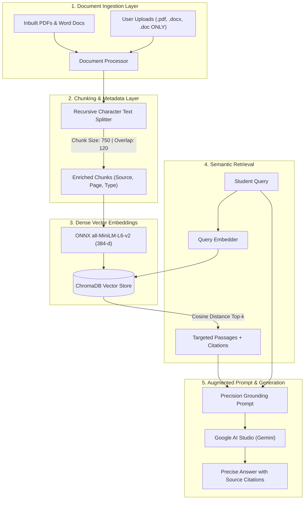

# 🎓 College GPT — Intelligent Campus Knowledge Assistant
> **Capstone Project**: Production-Grade Retrieval-Augmented Generation (RAG) Architecture for Academic Institutions.
> Exclusively powered by **Google AI Studio (Gemini)** with zero-cost browser-stored conversation history.

College GPT is an advanced AI campus assistant designed to eliminate information fragmentation in universities and colleges. By ingesting complex academic documents—including syllabus outlines, attendance regulations, examination schedules, grading policies, and campus hostel manuals—College GPT enables students and faculty to retrieve accurate, verified answers backed by **exact document and page-level source citations**.

---

## 🏛️ Project Highlights & Key Features

- **💎 Minimalist "PREMIUM VERSION" UI**:
  - Deep Indigo & Slate glassmorphic design system without noisy buttons.
  - Interactive Light / Dark theme toggle with persistence.
  - **Browser-Stored Chat History**: View and resume past conversations anytime, saved automatically in your browser's `localStorage` with zero cloud fees or database costs!
  - Collapsible **Verified Citation Cards**: Click on any document badge to view the exact quoted excerpt and similarity score.
  - Built-in **Text-to-Speech (Audio Readout)** and one-click copy.
  - Interactive Capstone Architecture Explainer modal for presentations and viva exams.

- **📚 Dual-Source Academic Knowledge Base**:
  - **Inbuilt Knowledge Base**: Comes preloaded with Bangalore University BCA Third Year Course Outline, Weekly Timetable, Exam Planner, Attendance Policies, and Campus & Hostel Rules.
  - **Dynamic Ingestion (PDF & Word Docs ONLY)**: Drag-and-drop or attach any `.pdf`, `.docx`, or `.doc` file directly in the chat or sidebar. It is parsed, chunked, and vector-indexed immediately without restarting the application!

- **⚡ Production RAG Pipeline (ChromaDB + Dense Embeddings)**:
  - Local ONNX `all-MiniLM-L6-v2` dense embeddings (384 dimensions) requiring zero cloud subscriptions for vectorization.
  - Persistent ChromaDB vector database with real-time add, query, and delete operations.
  - Cosine distance metric for targeted semantic retrieval.

- **🤖 Google AI Studio (Gemini) Integration**:
  - Powered by **Google AI Studio (`gemini-1.5-flash`)** — generous 100% free tier.
  - Targeted Answers: Specifically answers what is asked (e.g. asking for Tuesday's timetable outputs only Tuesday, not the whole week).
  - **Offline RAG Extractor Mode**: Runs 100% locally even before adding an API key, ensuring you can test and demonstrate the system offline anytime!

---

## 📐 Capstone RAG Model Architecture



---

## 📂 Project Directory Structure

```text
CollegeGPT/
├── app.py                      # Flask REST API server and routing
├── run_college_gpt.bat         # 1-Click Windows execution launcher
├── open_env.bat                # 1-Click Notepad opener for .env API key
├── requirements.txt            # Python dependencies
├── .env.example                # Environment configuration template
├── .env                        # Active Google AI Studio API key
├── chroma_db/                  # Persistent ChromaDB vector database
├── data/
│   ├── inbuilt/                # Preloaded official college documents
│   │   ├── 01_BCA_Third_Year_Course_Outline.pdf
│   │   ├── 02_BCA_Third_Year_Weekly_Timetable.pdf
│   │   ├── 03_BCA_Third_Year_Exam_Schedule_Planner.pdf
│   │   ├── 04_BCA_Third_Year_Attendance_Policy.pdf
│   │   └── 05_College_Hostel_and_Campus_Rules.docx
│   └── uploads/                # User uploaded PDFs and Word documents
├── src/
│   ├── document_processor.py   # PDF & Word text extraction and chunker
│   ├── vector_store.py         # ChromaDB interface and vector indexer
│   ├── llm_client.py           # Google AI Studio API connector & targeted extractor
│   ├── prompt.py               # Precision grounding prompt templates
│   └── rag_pipeline.py         # End-to-end RAG orchestrator
├── static/
│   ├── css/
│   │   └── premium.css         # Luxury glassmorphism design system
│   └── js/
│       └── app.js              # Real-time chat, browser chat history & citations
└── templates/
    └── index.html              # Minimalist, responsive single-page application
```

---

## 🚀 Quick Start Guide

### 1. Launching the Application
Double-click:
```bash
run_college_gpt.bat
```
Open your browser and navigate to:
```
http://localhost:8080
```

### 2. Adding your Google AI Studio API Key
1. Double click `open_env.bat` to open `.env` in Notepad.
2. Paste your free key from [Google AI Studio](https://aistudio.google.com/app/apikey):
   ```env
   GEMINI_API_KEY=AIzaSy...
   ```
3. Save (`Ctrl + S`). The app automatically picks up the key!

---

## 🌐 Cloud Deployment Guide

### Option 1: Deploy on Render (Recommended)
1. Fork or push this repository to your GitHub account (`https://github.com/jeel190/College-GPT`).
2. Log in to [Render](https://render.com).
3. Click **New +** $\rightarrow$ **Web Service**.
4. Connect your `College-GPT` GitHub repository.
5. Configure the service:
   - **Environment**: `Python 3`
   - **Build Command**: `pip install -r requirements.txt`
   - **Start Command**: `gunicorn -w 2 -b 0.0.0.0:$PORT app:app`
6. Under **Environment Variables**, add:
   - `GEMINI_API_KEY`: Your Google AI Studio API Key
   - `DEFAULT_LLM_PROVIDER`: `gemini`
   - `GEMINI_MODEL`: `gemini-3.5-flash`
7. Click **Create Web Service**. Your app is live!

### Option 2: Deploy on Vercel
1. Install Vercel CLI or import repository at [vercel.com](https://vercel.com).
2. Set Environment Variables in Project Settings:
   - `GEMINI_API_KEY`: Your Google AI Studio API Key
   - `DEFAULT_LLM_PROVIDER`: `gemini`
   - `GEMINI_MODEL`: `gemini-3.5-flash`
3. Deploy! Vercel automatically detects `vercel.json` and runs the Flask app serverless.

---

## 📜 License
Developed for Academic & Capstone Research. MIT License.
