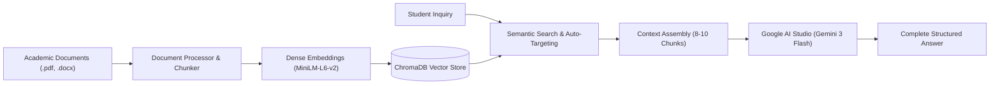

# 🎓 College GPT — AI Campus Knowledge Assistant

> **Production-Grade Academic RAG System Deployed on Vercel Serverless**  
> Powered by **Google AI Studio (Gemini)** with sub-second ChromaDB vector search and zero-cost client storage.

[](https://college-gpt-one.vercel.app)
[](https://college-gpt-one.vercel.app)
[](https://www.python.org/)
[](https://flask.palletsprojects.com/)
[](https://www.trychroma.com/)
[-orange.svg)](https://aistudio.google.com/)

---

## 📌 Overview

**College GPT** is an intelligent, context-grounded AI knowledge assistant built for university campuses. Instead of navigating complicated portals or reading through hundreds of pages of academic notices, course outlines, and schedules, students and faculty can query the system online and receive immediate, targeted, and verified answers.

The system is deployed globally as a live serverless cloud application on **Vercel**, backed by Google AI Studio's Gemini models for rapid grounded inference.

### ✨ Key Capabilities

- **🎯 Targeted Precision Answers**: Delivers strictly what was requested (e.g., asking for Tuesday's timetable outputs the complete Tuesday schedule from morning classes to afternoon practical labs).
- **🔤 Typo & Shorthand Tolerance**: Intelligently understands student typos and informal course abbreviations (e.g., `jango` $\rightarrow$ `Django`, `postgre` $\rightarrow$ `PostgreSQL`, `timetbl` $\rightarrow$ `timetable`, `atten` $\rightarrow$ `attendance`).
- **🛡️ Strict Out-of-Syllabus Grounding**: If an inquiry falls outside the indexed curriculum or documents, the system cleanly returns:
  > *"I do not have information regarding the question asked in the college documents."*
- **📎 In-Chat & Drag-and-Drop Document Ingestion**: Attach new departmental PDFs and Word documents (`.pdf`, `.docx`, `.doc`) directly in the chat bar. Documents are processed, chunked, and vector-indexed in real time.
- **💬 Zero-Cost Browser Chat History**: Complete conversation logs are saved locally in the client's browser (`localStorage`), eliminating the need for expensive external database subscriptions.
- **⚡ Pre-Bundled Dense Vector Search**: High-performance semantic similarity matching using ChromaDB and pre-bundled ONNX embeddings (`all-MiniLM-L6-v2`) without runtime download delays.
- **🚀 Ultra-Fast Serverless Inference**: Configured with direct greedy decoding and optimized thinking token budgeting for instant responses.

---

## 🏛️ System Architecture



---

## 📂 Project Structure

```text
CollegeGPT/
├── api/
│   └── index.py                # Vercel Serverless WSGI entrypoint & path router
├── vercel.json                 # Vercel serverless configuration & asset bundling
├── app.py                      # Flask core application & REST API routes
├── requirements.txt            # Minimal serverless Python dependencies
├── runtime.txt                 # Pinned Python 3.11 runtime
├── .env.example                # Template for environment variables
├── chroma_models/              # Pre-bundled ONNX embedding models (all-MiniLM-L6-v2)
│   └── all-MiniLM-L6-v2/
│       └── onnx/
│           ├── model.onnx      # 86MB dense embedding model (zero runtime download)
│           ├── tokenizer.json
│           └── vocab.txt
├── data/
│   ├── inbuilt/                # Default institutional documents & syllabi
│   │   ├── 01_BCA_Third_Year_Course_Outline.pdf
│   │   ├── 02_BCA_Third_Year_Weekly_Timetable.pdf
│   │   ├── 03_BCA_Third_Year_Exam_Schedule_Planner.pdf
│   │   ├── 04_BCA_Third_Year_Attendance_Policy.pdf
│   │   ├── 05_College_Hostel_and_Campus_Rules.docx
│   │   └── Vsem_FullStackDevelopmet.pdf
│   └── uploads/                # Dynamic user-uploaded documents (.gitkeep)
├── chroma_db/                  # Pre-indexed persistent ChromaDB database
├── src/
│   ├── document_processor.py   # Multi-format document parser & text chunker
│   ├── vector_store.py         # ChromaDB indexing & semantic query engine
│   ├── llm_client.py           # Google AI Studio Gemini API connector
│   ├── prompt.py               # Grounded academic system prompt templates
│   └── rag_pipeline.py         # End-to-end RAG orchestrator & status manager
├── static/
│   ├── css/
│   │   └── premium.css         # Modern dark/light responsive interface
│   └── js/
│       └── app.js              # Real-time chat, file uploads & markdown rendering
└── templates/
    └── index.html              # Single-page web application
```

---

## 🌐 Serverless Deployment on Vercel

This repository is pre-configured for automated continuous deployment on [Vercel](https://vercel.com):

1. **Import Git Repository**:
   - In your Vercel Dashboard, click **Add New... $\rightarrow$ Project**.
   - Select `College-GPT` and click **Import**.

2. **Project Settings**:
   - **Framework Preset**: `Flask` (or leave as detected).
   - **Root Directory**: `./`.
   - **Build & Output Settings**: Leave toggles default (no override needed).

3. **Environment Variables**:
   Add the following environment variables in the Vercel dashboard:
   - `GEMINI_API_KEY`: Your free key from [Google AI Studio](https://aistudio.google.com/app/apikey).
   - `GEMINI_MODEL`: `gemini-3-flash-preview`
   - `DEFAULT_LLM_PROVIDER`: `gemini`

4. **Deploy**:
   - Click **Deploy**. Vercel compiles the serverless function and packages the pre-indexed database and models in ~30 seconds.
   - Your application is live at `https://<your-project>.vercel.app`.

> [!NOTE]
> Every subsequent `git push origin main` triggers an automatic, zero-downtime serverless deployment on Vercel.

---

## 💻 Local Development

To run or test locally on your machine:

1. **Install Dependencies**:
   ```bash
   pip install -r requirements.txt
   ```

2. **Set Environment Variables**:
   Create a `.env` file in the root directory:
   ```env
   GEMINI_API_KEY=your_google_ai_studio_api_key_here
   GEMINI_MODEL=gemini-3-flash-preview
   DEFAULT_LLM_PROVIDER=gemini
   PORT=8080
   ```

3. **Start Local Server**:
   ```bash
   python app.py
   ```
   Open `http://localhost:8080` in your web browser.

---

## 🛠️ Technology Stack

| Layer | Technology | Purpose |
| :--- | :--- | :--- |
| **Cloud Hosting** | **Vercel Serverless** | Global edge deployment with automated CI/CD and zero server maintenance |
| **Serverless Gateway** | **WSGI Path Middleware** | Custom WSGI middleware mapping wildcard dynamic paths to Flask endpoints |
| **LLM Engine** | **Google AI Studio (Gemini 3 Flash)** | Context-grounded inference with 2,500 token capacity and deterministic decoding |
| **Vector Database** | **ChromaDB** | High-speed dense vector store with source-filtering and similarity search |
| **Embedding Model** | **ONNX all-MiniLM-L6-v2** | Pre-bundled 384-dimensional dense semantic vectors (zero network latency) |
| **Backend Framework** | **Flask (Python 3.11)** | Lightweight RESTful application handling queries, uploads, and reindexing |
| **Frontend UI** | **Vanilla JS + Modern CSS** | Clean glassmorphic UI with zero external runtime dependencies |
| **Client Storage** | **Browser localStorage** | Persistent conversation history with zero external database subscriptions |

---

## 📄 License

This project is open-source and created for academic, capstone, and research purposes.
