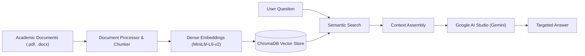

# 🎓 College GPT — Academic Knowledge Assistant

> An intelligent, AI-powered Retrieval-Augmented Generation (RAG) assistant designed for college students and faculty.  
> Powered by **Google AI Studio (Gemini)** with fast local vector search and zero-cost browser chat history.

---

## 📌 Overview

**College GPT** solves information fragmentation in academic institutions. Instead of manually searching through lengthy syllabus PDFs, circulars, or timetable spreadsheets, students and faculty can ask direct questions and receive fast, accurate answers.

### ✨ Key Capabilities

- **🎯 Targeted Answers**: Extracts and presents strictly what was asked (e.g., asking for Tuesday's timetable returns only Tuesday's schedule).
- **🔤 Typo & Spelling Tolerance**: Understands student shorthand and spelling variations (e.g., `jango` $\rightarrow$ `Django`, `postgre` $\rightarrow$ `PostgreSQL`, `timetbl` $\rightarrow$ `timetable`).
- **🛡️ Out-of-Syllabus Grounding**: If a question is outside the course documents or campus notices, it cleanly clarifies:
  > *"I do not have information regarding the question asked in the college documents."*
- **📎 In-Chat Document Upload**: Attach departmental PDFs and Word documents (`.pdf`, `.docx`, `.doc`) directly at the chat bar. Newly uploaded files are parsed, chunked, and indexed into the vector store in real time.
- **💬 Browser-Stored Chat History**: Conversations are saved locally in the browser (`localStorage`), allowing you to review past chats without external database or cloud storage costs.
- **⚡ Local Dense Vector Search**: High-performance semantic retrieval using ChromaDB and ONNX embeddings (`all-MiniLM-L6-v2`).
- **🤖 Powered by Google AI Studio**: Backed by Google's Gemini models for rapid, context-grounded reasoning.

---

## 🏛️ System Architecture



---

## 📂 Project Structure

```text
CollegeGPT/
├── app.py                      # Flask application and REST endpoints
├── run_college_gpt.bat         # 1-Click launcher for Windows
├── open_env.bat                # Quick shortcut to configure .env
├── requirements.txt            # Python dependencies
├── Procfile                    # Render process file
├── render.yaml                 # Render deployment blueprint
├── .env.example                # Sample environment variables
├── data/
│   ├── inbuilt/                # Default academic curriculum & policies
│   └── uploads/                # User-attached PDFs and Word files
├── chroma_db/                  # Persistent ChromaDB vector database
├── src/
│   ├── document_processor.py   # PDF and Word document extraction
│   ├── vector_store.py         # ChromaDB indexing & semantic query
│   ├── llm_client.py           # Google AI Studio Gemini integration
│   ├── prompt.py               # Grounded academic prompts
│   └── rag_pipeline.py         # Complete RAG inference workflow
├── static/
│   ├── css/
│   │   └── premium.css         # Modern, clean UI styling
│   └── js/
│       └── app.js              # Real-time chat & local storage history
└── templates/
    └── index.html              # Main chat interface
```

---

## 🚀 Running Locally

### Prerequisites
- Python 3.10 or higher installed on your computer.

### Quick Start (Windows)
1. Double-click **`run_college_gpt.bat`** (or run `python app.py` in your terminal).
2. Open your web browser and navigate to:
   ```
   http://localhost:8080
   ```

### Configuring Google AI Studio API Key
1. Get a free API key from [Google AI Studio](https://aistudio.google.com/app/apikey).
2. Open `.env` (or double-click `open_env.bat`) and paste your key:
   ```env
   GEMINI_API_KEY=your_gemini_api_key_here
   ```
3. Save the file. The server automatically detects your key without restarting.

---

## ☁️ Deployment on Render

This project is pre-configured for simple hosting on [Render](https://render.com):

1. Push your code to your GitHub repository:
   ```bash
   git push origin main
   ```
2. Log in to your [Render Dashboard](https://dashboard.render.com/).
3. Click **New +** $\rightarrow$ **Web Service** and connect your `College-GPT` repository.
4. Render will automatically detect the project configuration from `render.yaml` and `Procfile`:
   - **Environment**: `Python 3`
   - **Build Command**: `pip install -r requirements.txt`
   - **Start Command**: `gunicorn -w 1 --threads 4 -b 0.0.0.0:$PORT app:app`
5. Under **Environment Variables**, add:
   - `GEMINI_API_KEY` = *(your Google AI Studio API key)*
6. Click **Deploy Web Service**. Your College GPT instance will be live on the web!

---

## 📄 License
This project is open-source and created for academic and research purposes.
