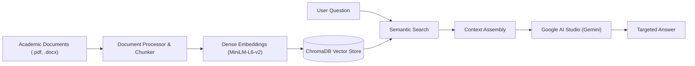

# 🎓 College GPT — AI Campus Knowledge Assistant

> **Production-Grade Academic RAG System Deployed on Render Cloud**  
> Powered by **Google AI Studio (Gemini)** with high-speed ChromaDB vector search and zero-cost browser storage.

[](https://dashboard.render.com/web/new)
[](https://www.python.org/)
[](https://flask.palletsprojects.com/)
[](https://www.trychroma.com/)
[-orange.svg)](https://aistudio.google.com/)
[](https://render.com/)

---

## 📌 Overview

**College GPT** is an intelligent, context-grounded AI knowledge assistant built for university campuses. Instead of navigating complicated portals or reading through hundreds of pages of academic notices, course outlines, and schedules, students and faculty can query the system online and receive immediate, targeted, and verified answers.

The system is deployed as a live cloud service on **Render**, backed by Google AI Studio's Gemini models for sub-second grounded inference.

### ✨ Key Capabilities

- **🎯 Targeted Precision Answers**: Delivers strictly what was requested (e.g., asking for Tuesday's timetable outputs only Tuesday's schedule, leaving out unrelated days).
- **🔤 Typo & Shorthand Tolerance**: Intelligently understands student typos and informal course abbreviations (e.g., `jango` $\rightarrow$ `Django`, `postgre` $\rightarrow$ `PostgreSQL`, `timetbl` $\rightarrow$ `timetable`).
- **🛡️ Strict Out-of-Syllabus Grounding**: If an inquiry falls outside the indexed curriculum or documents, the system cleanly returns:
  > *"I do not have information regarding the question asked in the college documents."*
- **📎 In-Chat & Drag-and-Drop Document Ingestion**: Attach new departmental PDFs and Word documents (`.pdf`, `.docx`, `.doc`) directly at the chat bar. Documents are processed, chunked, and vector-indexed in real time.
- **💬 Zero-Cost Browser Chat History**: Complete conversation logs are saved locally in the client's browser (`localStorage`), eliminating the need for expensive external database subscriptions.
- **⚡ Local Dense Vector Search**: High-performance semantic similarity matching using ChromaDB and ONNX embeddings (`all-MiniLM-L6-v2`).
- **🚀 Ultra-Fast Inference**: Configured with greedy decoding (`temperature: 0.0`) and extended 120-second connection keep-alive for reliable cloud operation.

---

## 🏛️ System Architecture



---

## 📂 Project Structure

```text
CollegeGPT/
├── app.py                      # Production Flask application & REST endpoints
├── Procfile                    # Render Gunicorn WSGI process configuration
├── render.yaml                 # Render cloud deployment blueprint
├── requirements.txt            # Production Python dependencies
├── runtime.txt                 # Pinned Python runtime for cloud builds
├── .env.example                # Template for cloud environment variables
├── data/
│   ├── inbuilt/                # Default institutional documents & syllabi
│   │   ├── 01_BCA_Third_Year_Course_Outline.pdf
│   │   ├── 02_BCA_Third_Year_Weekly_Timetable.pdf
│   │   ├── 03_BCA_Third_Year_Exam_Schedule_Planner.pdf
│   │   ├── 04_BCA_Third_Year_Attendance_Policy.pdf
│   │   ├── 05_College_Hostel_and_Campus_Rules.docx
│   │   └── Vsem_FullStackDevelopmet.pdf
│   └── uploads/                # Dynamic user-uploaded documents (.gitkeep)
├── chroma_db/                  # Persistent ChromaDB vector database
├── src/
│   ├── document_processor.py   # Multi-format document parser & text chunker
│   ├── vector_store.py         # ChromaDB indexing & semantic query engine
│   ├── llm_client.py           # Google AI Studio Gemini API connector
│   ├── prompt.py               # Grounded academic system prompt templates
│   └── rag_pipeline.py         # End-to-end RAG orchestrator & status manager
├── static/
│   ├── css/
│   │   └── premium.css         # Modern dark/light responsive interface
│   └── js/
│       └── app.js              # Real-time chat, file uploads & browser storage
└── templates/
    └── index.html              # Single-page web application
```

---

## 🌐 Cloud Deployment (Render)

This repository is pre-configured for automated continuous deployment on [Render](https://render.com):

1. **Link Repository**: Connect `https://github.com/jeel190/College-GPT` to a new **Web Service** on Render.
2. **Auto-Configuration**: Render automatically detects the configuration from `render.yaml` and `Procfile`:
   - **Runtime**: `Python 3`
   - **Build Command**: `pip install -r requirements.txt`
   - **Start Command**: `gunicorn -w 1 --threads 4 --timeout 120 -b 0.0.0.0:$PORT app:app`
   - **Compute Plan**: `Free` ($0/month)
3. **Set Environment Variable**:
   - `GEMINI_API_KEY`: Paste your free key from [Google AI Studio](https://aistudio.google.com/app/apikey).
4. **Deploy**: Click **Create Web Service**. Your application is instantly hosted live on your custom `*.onrender.com` URL.

> [!NOTE]
> Every subsequent `git push origin main` triggers an automatic, zero-downtime redeployment on Render.

---

## 💻 Optional: Local Testing

To test or develop locally on your machine:

1. **Install Dependencies**:
   ```bash
   pip install -r requirements.txt
   ```
2. **Add API Key**:
   Create a `.env` file in the root directory:
   ```env
   GEMINI_API_KEY=your_google_ai_studio_api_key_here
   ```
3. **Start Server**:
   ```bash
   python app.py
   ```
   Open `http://localhost:8080` in your web browser.

---

## 🛠️ Technology Stack

| Layer | Technology | Purpose |
| :--- | :--- | :--- |
| **Cloud Hosting** | **Render** | Zero-configuration web service deployment & auto-rebuilds |
| **LLM Engine** | **Google AI Studio (Gemini)** | Context-grounded inference with greedy deterministic decoding |
| **Vector Store** | **ChromaDB** | High-speed local embeddings index & cosine similarity search |
| **Embeddings** | **ONNX all-MiniLM-L6-v2** | 384-dimensional dense semantic representations |
| **Backend API** | **Flask + Gunicorn** | Production WSGI application handling concurrent queries |
| **Frontend UI** | **Vanilla JS + Modern CSS** | Clean glassmorphic UI with zero external runtime dependencies |
| **Client Storage** | **Browser localStorage** | Persistent conversation history with zero database hosting fees |

---

## 📄 License
This project is open-source and created for academic, capstone, and research purposes.
